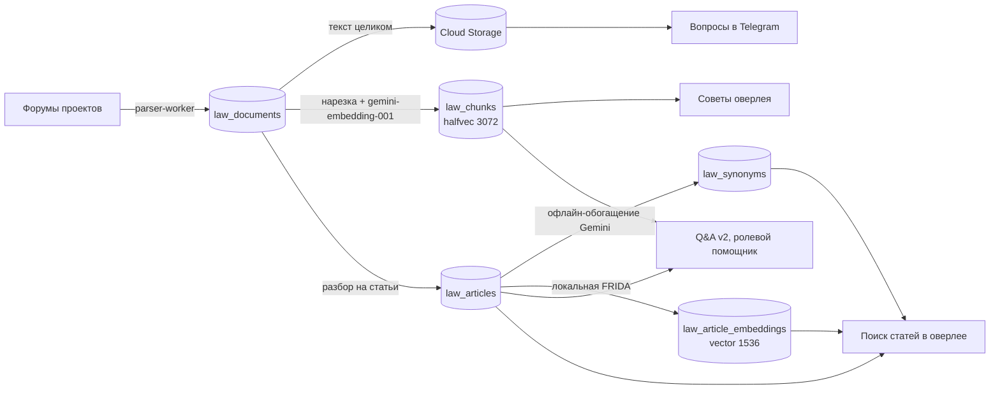

# Как TurgovBot работает с законами: RAG, векторы, поиск

У каждого игрового сервера своя законодательная база — десятки кодексов на форуме,
которые постоянно правят. Бот должен отвечать по законам **именно этого** сервера и
ссылаться на реальные статьи. Для этого в проекте четыре связанных механизма:

1. **Сбор законов** с форумов в базу.
2. **Ответы на вопросы в Telegram** — модель-маршрутизатор выбирает нужные кодексы,
   их целиком отдают генерирующей модели.
3. **Векторный RAG по фрагментам** — для советов оверлея, Q&A v2 и ролевого помощника.
4. **Поиск статей без LLM** — гибрид полнотекстового поиска, синонимов и локальных
   векторов для вкладки поиска в оверлее.

## 1. Сбор законов

- Список проектов, серверов и разделов форума — в `law_sources_data.py`. Ключ
  сервера (`la_puerta`, `memphis`…) — это `server_id`, по нему разделено всё дальше.
- Раз в 47 часов `knowledge_base_manager.py` обходит разделы, до четырёх серверов
  одновременно.
- Сам разбор делает отдельный сервис `parser_worker/worker.py`: Playwright с Firefox,
  вход на форумы, которые закрыты логином, и FlareSolverr для форумов за Cloudflare.
  Ссылки на Google Docs внутри темы тоже скачиваются.
- Документ ложится в `law_documents` (сервер, тема, название, текст, хеш). Текст
  целиком дополнительно выгружается в Cloud Storage для «документного» режима.
- Две защиты от порчи базы. Если обход раздела прошёл не полностью, синхронизация
  останавливается. Если за раз пропало бы больше половины законов сервера — удаление
  блокируется.
- Изменённые документы помечаются `derived_sync_pending`, и производные данные
  (фрагменты, каталог статей) пересобираются, пока маркер не снимется.

## 2. Ответы на вопросы в Telegram

Основной путь вопросов **не векторный**: модель читает нужные кодексы целиком,
а не набор вырванных фрагментов.

1. Модель-маршрутизатор `gemini-3.1-flash-lite` получает список названий документов
   сервера и выбирает подходящие (`services/qa_service.py`).
2. Выбранные документы целиком передаются в `gemini-3-flash-preview` как файлы из
   Cloud Storage. Если маршрутизатор ничего не выбрал — передаются все документы сервера.
3. Прецеденты подбираются тем же способом (`precedents_manager.py`).

Недостаток очевиден: стоимость и задержка растут вместе с размером кодекса.
Поэтому для оверлея и новых режимов сделан векторный контур.

## 3. Векторный RAG по фрагментам

### Нарезка

`services/indexing_service.py` режет документ по заголовкам «Статья», «Глава»,
«Раздел», «§», «пункт», в том числе по «голым» номерам `6.1` в кодексах без слова
«Статья». Блоки длиннее 1200 символов упаковываются по абзацам. Только абзац длиннее
1200 символов режется жёстко, с перекрытием 150 символов. Фрагменты документа
переписываются одной транзакцией.

### Эмбеддинги и хранение

- Модель `gemini-embedding-001`, 3072 измерения, типы задач `RETRIEVAL_DOCUMENT` для
  фрагментов и `RETRIEVAL_QUERY` для запроса (`services/embeddings.py`). Батчи по 100,
  через общий rate-limiter с повторами.
- Таблица `law_chunks`, колонка pgvector `halfvec(3072)` — обычный `vector` не
  индексируется HNSW больше 2000 измерений, `halfvec` — до 4000. Индекс HNSW по
  косинусной дистанции.

### Поиск и сборка контекста

`services/retrieval_service.py` ищет ближайшие фрагменты внутри `server_id`, затем
группирует их по статьям и **собирает статью целиком** из всех её фрагментов — модель
видит норму полностью, а не обрывок. Документам, важным для выбранной роли (адвокат,
прокурор), даётся небольшой бонус. Общий объём контекста ограничен 40 000 символов.

Где это используется:

- **Советы оверлея** (`services/advice_service.py`). Быстрая модель
  `gemini-3.1-flash-lite` превращает расшифровку сцены в 1–4 поисковых запроса. По
  каждому берётся 6 фрагментов, если пусто — 14 по исходному тексту. Ответ пишет
  `gemini-3-flash-preview` (глубокий разбор — `gemini-3.1-pro-preview`). Строки, где
  модель сослалась на статью, которой нет в контексте, вырезаются, и модель переписывает
  ответ ещё раз.
- **Q&A v2** (`services/qa_v2_service.py`, пока только для админов на одном сервере).
  Контекст гибридный: 40 статей из каталога поиска (раздел 4) плюс 24 ближайших
  фрагмента, плюс соседние статьи (±2), до 100 000 символов. Модель
  `gemini-3.5-flash-lite` с размышлением получает инструмент `search_laws` и до трёх
  раз может дозапросить статьи сама.
- **Ролевой помощник** (`ASSISTANT_LAW_CONTEXT_MODE=articles`) собирает контекст тем же
  способом по текущему запросу, фактам дела и последним репликам. Если статей не
  нашлось, откатывается на документы целиком.

## 4. Поиск статей для оверлея — без LLM в рантайме

Второй контур отвечает на запрос вида «мента избили» или «статья 12.8 ук» за доли
секунды и не зовёт модель. Каждый ответ — конкретные статьи с номером, названием и
санкцией, а не сгенерированный текст.

### Каталог

`services/law_catalog_service.py` режет те же `law_documents` на отдельные нормы и
кладёт в `law_articles`: главы, разделы, статьи, номер, заголовок, полный текст, хеш.
Разбор кодексов форумов — самая хрупкая часть: встречаются «голые» номера `6.1` без
слова «Статья», разорванные на две строки заголовки, римские цифры из кириллицы,
ссылки на чужие статьи, похожие на заголовки. Под каждый такой случай есть правило и
регрессионный тест.

При пересборке каталога статьи **сохраняют свои ID**: новая версия сопоставляется со
старой по телу, заголовку, номеру и порядку. Это важно, потому что избранное в оверлее
хранит ID статьи.

### Офлайн-обогащение

Отдельным проходом Gemini (`LAW_CATALOG_ENRICH_MODEL`, по умолчанию `gemini-3.5-flash`)
для каждой статьи генерирует понятное название, краткую санкцию и 12–15 поисковых
синонимов, в том числе сленговых. Модель видит соседние статьи и свои прежние
синонимы, чтобы разводить похожие нормы. Ответ проходит проверку формы, количества
и коллизий: один синоним не может принадлежать двум статьям сервера. В рантайме
модель не вызывается — используются только сохранённые синонимы.

Проверка того, что синоним **по смыслу** подтверждается текстом статьи, — это и есть
незаконченная система v3, см. [ENRICHMENT_V3.md](ENRICHMENT_V3.md).

### Векторы: локальная FRIDA

Смысловая «нога» поиска — модель [`ai-forever/FRIDA`](https://huggingface.co/ai-forever/FRIDA),
запущенная локально на CPU через sentence-transformers (`services/law_embedder.py`):

- 1536 измерений, пулинг CLS, векторы нормализованы;
- префиксы `search_query: ` для запроса и `search_document: ` для статьи;
- хранение в `law_article_embeddings`, pgvector `vector(1536)`, индекс HNSW по косинусу;
- порог похожести 0,25 (`LAW_VECTOR_MIN_SIM`).

Векторы считает отдельный процесс `law-embedding-worker` из очереди `law_embedding_jobs`,
чтобы тяжёлый пересчёт не тормозил API. У пространства векторов есть «паспорт»
(`law_embedding_spaces`): модель, ревизия весов, размерность, префиксы, пулинг, версия
рецепта текста. Векторы из разных пространств никогда не смешиваются.

Главное правило: **векторная нога голосует, только когда корпус сервера посчитан
на 100%**. Если хотя бы часть статей ещё без векторов, поиск честно работает в режиме
`keyword_only` и сообщает об этом в ответе — иначе посчитанные статьи несправедливо
выигрывали бы у непосчитанных.

По тем же векторам строятся «похожие статьи» (`law_article_related`, до 5 штук,
порог 0,55).

### Запрос: нормализация и ноги

`normalize_query` чистит запрос и переводит сленг в юридические понятия по карте из
120+ проверенных пар («мент» → сотрудник полиции, «замочил» → убийство и т.д.).
Затем параллельно запускаются ноги — независимые способы найти статью:

| Нога | Что ищет | Вес |
|---|---|---|
| `intent_phrase` | строгая ситуационная фраза («человек в розыске») по тексту законов сервера | 4.0 |
| `phrase_title` | фраза целиком в заголовке | 2.25 |
| `code`, `explicit_code_title` | номер статьи, «статья N <название кодекса>» | 2.0 |
| `title`, `legal_title` | слова в заголовке | 2.0 |
| `synonym_exact` | точное совпадение с синонимом | 2.0 |
| `synonym` | частичное совпадение с синонимом | 1.5 |
| `legal_fts` | полнотекстовый поиск PostgreSQL по юридическим переформулировкам | 1.25 |
| `fts` | полнотекстовый поиск по тексту статьи | 1.0 |
| `vector` | FRIDA | 1.0 (1.8 при условном бусте) |
| `trgm` | триграммы, опечатки | 0.8 |

Результаты сливаются **взвешенным Reciprocal Rank Fusion** (`k = 60`): каждая нога
даёт статье `вес / (60 + место)`. Слабые нечёткие совпадения сохраняют свою низкую
уверенность. Строгое совпадение намерения закрепляется выше суммы шумных голосов.

Каждая нога сообщает статус `ok`, `empty`, `skipped`, `timeout` или `error`, поэтому
«ничего не нашлось» не путается с «сломалось». Ответ содержит `search_mode`
(`full`, `partial`, `keyword_only`), флаг `degraded` и предупреждения. Есть таймауты
на каждый этап: SQL 1,5 с, вектор запроса 2 с, весь поиск 8 с.

Каждый запрос и показанная выдача пишутся в `law_search_events` без данных
пользователя — для разбора качества (`scripts/analyze_law_search_logs.py`).

## Ограничения

- Поиск по `law_chunks` чисто векторный: без полнотекстовой ноги и без порога
  похожести. Нерелевантные фрагменты отсекает только лимит количества.
- Первичная векторная индексация сервера запускается вручную (`index_server_laws`),
  дальше изменения подхватываются автоматически.
- Эмбеддинги Gemini упираются в квоту: полная переиндексация большого сервера идёт
  часами.
- Качество поиска статей держится на офлайн-синонимах. Модель, которая их пишет,
  иногда выдумывает: путает «может» и «обязан», меняет роли суда и полиции, теряет
  условия. Проверка формы этого не ловит — см. [незаконченную систему v3](ENRICHMENT_V3.md).
